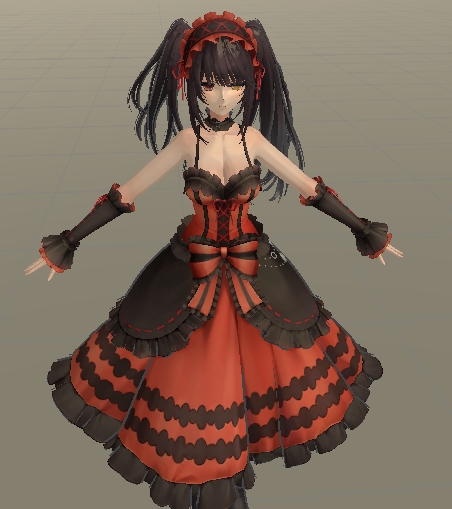
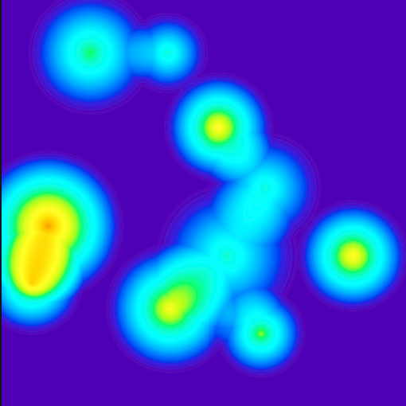

# TA-Learning

* 仅作学习记录。持续更新。

## 01 [NPR](./TA_Learning/Assets/Cartoon)

* 卡通渲染，暂时只写了外轮廓描边、纯色块、sss次表面散射和高光。后续会试着做做NPR+PBR效果。
* 示例图：
* 

## 02 [毛玻璃](./TA_Learning/Assets/Glass)

* 毛玻璃效果。

## 03 [放大镜](./TA_Learning/Assets/Megaloscope)

* 放大镜效果。

## 04 [移动模糊](./TA_Learning/Assets/MotionBlur)

* 移动模糊效果。

## 05 [像素化](./TA_Learning/Assets/Pixelization)

* 后处理像素化效果。

## 06 [景深](./TA_Learning/Assets/SceneDepth)

* 景深效果。

## 07 [碎屏](./TA_Learning/Assets/ScreenCrack)

* 屏幕破碎效果。

## 08 [毛皮着色器](./TA_Learning/Assets/FurShader)
* 动态毛皮着色器。
* 示例图：
* 

## 09 [热度图](./TA_Learning/Assets/HeatMap)
* 热度图。
* 示例图：
* 