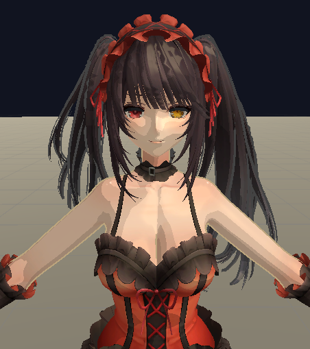
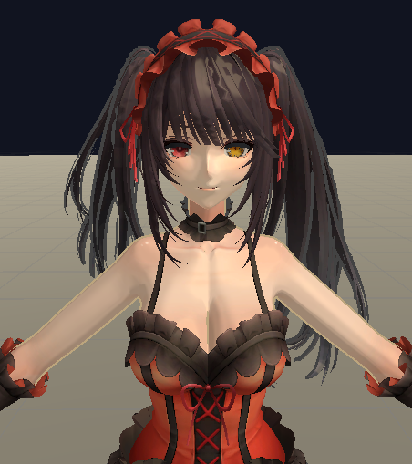

# 一编

## 大致思路

* 我们将整个卡通渲染分为几个部分：
  1. 渲染轮廓线；
  2. 离散色阶；
  3. sss效果处理；
  4. 高光。

* 首先是渲染轮廓线部分，使用过程式几何轮廓线渲染：
  * 分为两个Pass，第一个Pass渲染背面的面片，剔除前面。采样三角形顶点，沿着法线方向加一个值，这样向外扩张一点距离就可以使得轮廓线可见：
  ```hlsl
   v.vertex.xyz += normalize(v.normal) * _OutlineWidth;
   o.vertex = UnityObjectToClipPos(v.vertex);
  ```
  * 第二个Pass正常渲染。

* 然后是离散色阶部分。这里可以使用两种做法：
  1. 使用ramp贴图；
  2. 使用系数表；
* 在对于某种材质有要求（例如黑丝质感等）会倾向于使用ramp贴图。
* 这里直接使用系数表控制。
  * 我们设定三个阈值、这样能划分成四个区域。
  * 每个区域是一个指定的值shade。
  * 通过判断NdotL大小确定明暗，得到shade。
  * 最后将得到的shade乘以直接光照。
  ```hlsl
    if (NdotL >= _Threshold3)
       {
            toonLight = _Shade3;
       }
    // ...
    // 其他if
    // ...
    float3 direct = _LightColor0.rgb * toonLight;
  ```

* 然后是通过mask贴图去做sss效果模拟皮肤质感。
  * 核心公式如下：
  $$S=[Saturate(\frac{-N*L+\omega}{1+\omega})]^p$$
  * N表示世界空间法线；
  * L表示指向光源方向；
  * ω表示散射范围，控制散射向明暗交界处延伸的程度；
  * p表示散射锐度，控制散射区域的集中程度。
  * 最后把散射颜色叠加进结果中。

* 最后是高光部分。
  * 经典Blinn-Phong公式：
  $$H=\frac{L+V}{||L+V||}$$
  $$S=max(0,N\cdot H)^n$$
  * L表示指向光源方向；
  * V表示指向摄像机的方向；
  * H表示半程向量；
  * N表示世界空间法线；
  * n表示高光指数，越大高光越小。
  * 最后一样得加进结果中。

# 二编

## 优化

* 我们发现不同色块之间有明显的硬边缘过渡。
* 正好最近开始在学习UnityShaderBible，刚了解了硬边缘软边缘的概念。所以来改一下这部分。
* 出现这个效果的原因是我对不同色阶直接用的if判断。
* 因此我现在的想法是给一个过渡宽度变量，然后让每个域±这个宽度变量大小的地方作为过渡区域。
* 把过渡区域smoothstep，然后进行shade插值。
* 具体写法类似下面这样：
    ```hlsl
    else if (NdotL < _Threshold1 + halfWidth)
        {
            float t = smoothstep(_Threshold1 - halfWidth, _Threshold1 + halfWidth, NdotL);
            toonLight = lerp(_Shade0, _Shade1, t);
        }
    ```
* 前后效果对比：
    
    
* 现在视觉上的问题解决了，接下来得改一下if-else写法（真的很糟糕的写法，当时为了即使提交上作业就没有再细想）。
* smoothstep本身就包含了对范围的判断。所以整段代码优化为：
    ```hlsl
        float toonLight = _Shade0;
        float halfWidth = max(0, _TransitionWidth);
        float t1 = smoothstep(_Threshold1 - halfWidth, _Threshold1 + halfWidth, NdotL);
        toonLight += (_Shade1 - _Shade0) * t1;
        float t2 = smoothstep(_Threshold2 - halfWidth, _Threshold2 + halfWidth, NdotL);
        toonLight += (_Shade1 - _Shade0) * t2;
        if (_StepCount > 3.5)
            {
                float t3 = smoothstep(_Threshold3 - halfWidth, _Threshold3 + halfWidth, NdotL);
                toonLight += (_Shade1 - _Shade0) * t3;
            }
    ```
* 需要注意的是，没有if-else是不能用lerp的，多个lerp会使得后面的覆盖前面的lerp结果。